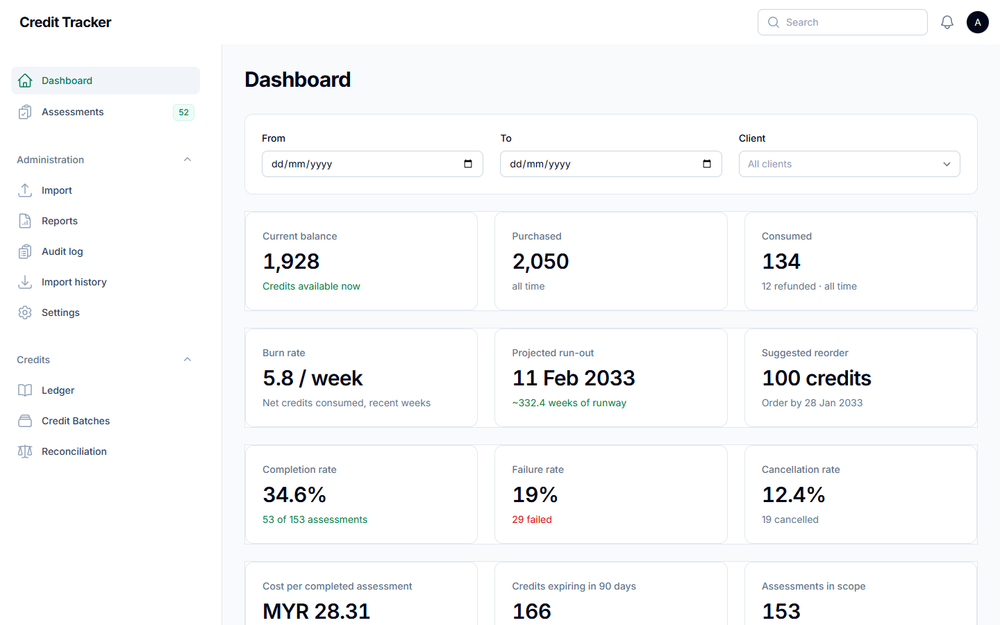
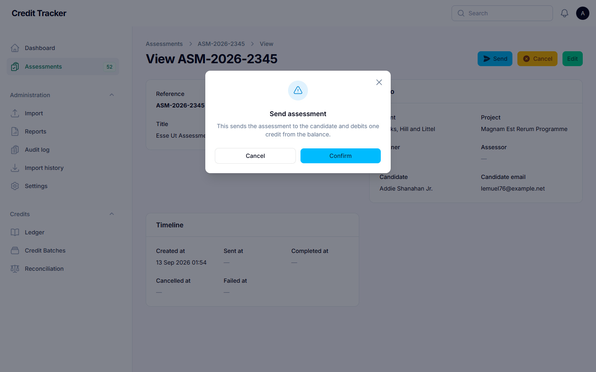
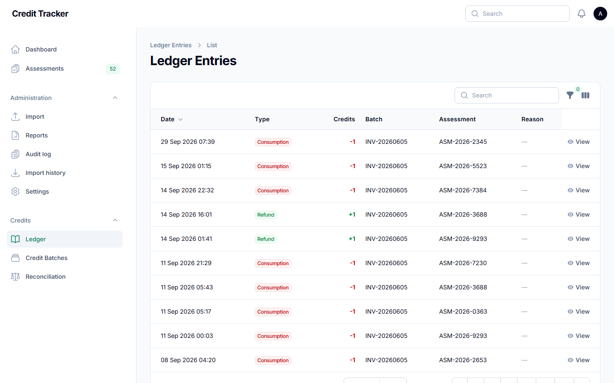
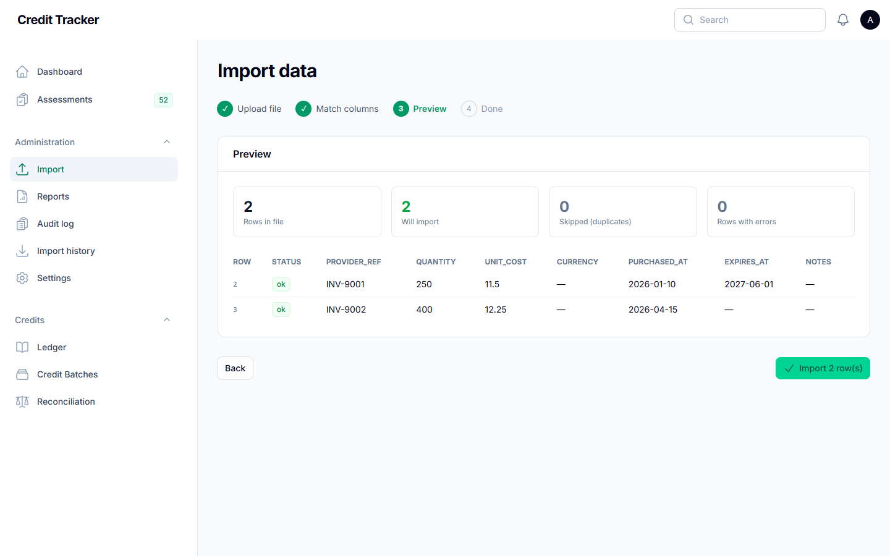
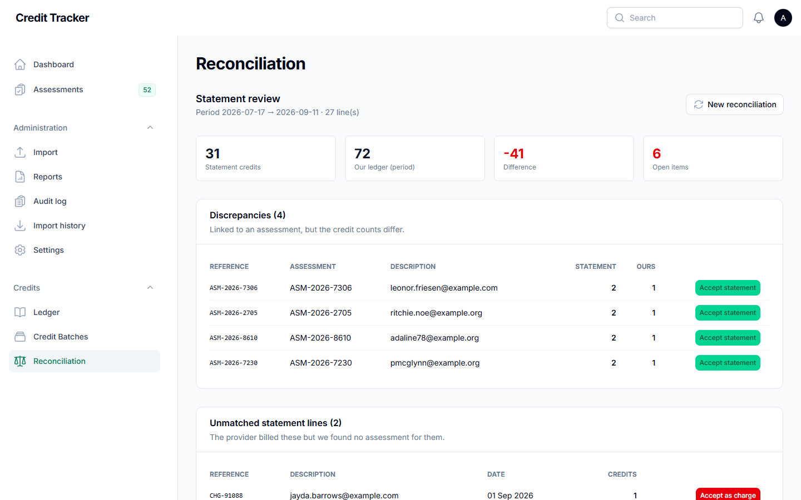
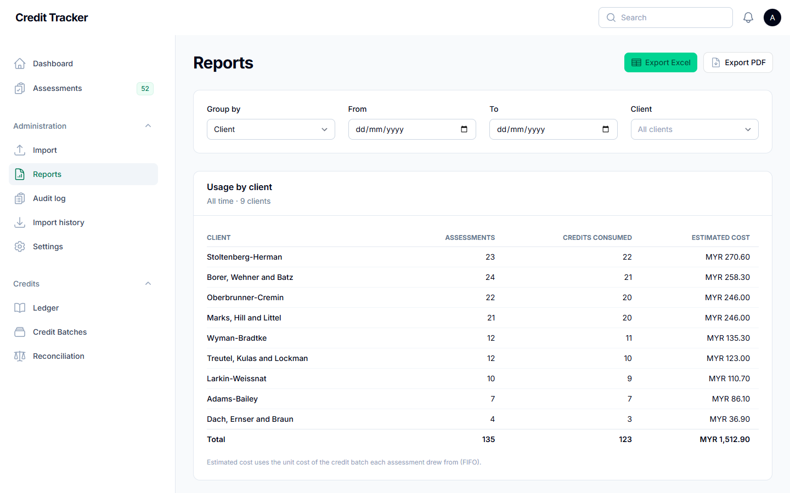
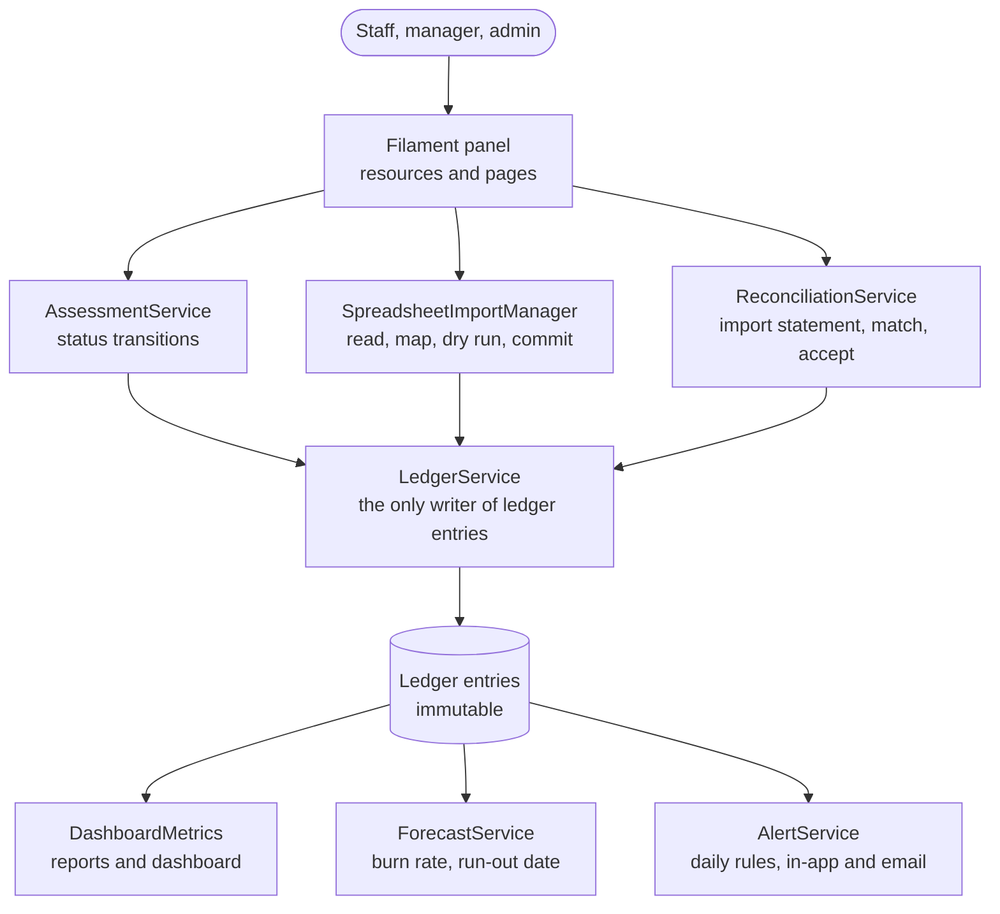

# 💳 Credit Tracking & Usage Monitoring System

> Replaces a manually kept Excel sheet with a **tamper-proof credit ledger**: a live balance, usage by client and partner, monthly reconciliation against the provider's statement, and a forecast of when the credits run out.

**Status:** Private repository. Source code available on request (interviews, review, collaboration).

**Walkthrough video:** on my portfolio, <https://www.anwarhadif-portfolio.com/#projects>.

A working prototype pitched to the DXP Digital Acceleration Program. All names and emails in the screenshots are demo data.

---

## The problem

A consulting firm buys prepaid assessment credits from a third-party platform that offers **no API, no live counter and no usage dashboard**. Usage was tracked by hand in Excel: nobody knew the balance without asking the provider, records went missing or were duplicated, and disagreements with the monthly invoice only surfaced when it was too late to challenge them.

A dashboard on top of the spreadsheet would not fix that, because the real problem was the manual data entry. The firm needed its own independent record of truth.

## What it does

1. **Credit ledger.** Every top-up, assessment, refund, adjustment and reconciliation is an immutable ledger entry; the balance is always derived from it, never typed in.
2. **Assessments.** Staff log an assessment as they send it (Created, Sent, Completed, Cancelled, Failed). Status changes post the matching ledger entries automatically.
3. **Spreadsheet import.** Historical records and provider exports come in through a wizard: upload, match columns, preview (with duplicates and errors flagged), then import.
4. **Reconciliation.** The provider's monthly statement is matched against the ledger by reference, then by candidate email or name within a few days of the charge. Discrepancies and unmatched lines are listed for review, and accepting one posts a correction.
5. **Reports, alerts and forecast.** Usage and cost by client, partner, project and assessment type (Excel and PDF export); alerts for low balance, expiring credits, a burn-rate spike, a projected run-out and an unreconciled statement; a burn-rate forecast of the run-out date and when to reorder.

---

## Screenshots

| | |
|---|---|
|  **Live balance and run-out forecast** |  **Send an assessment, credit deducted** |
|  **Every movement in the ledger** |  **Import spreadsheets with a preview** |
|  **Reconcile the provider statement** |  **Usage reports by client or partner** |

---

## Tech stack

- **Laravel 13** (PHP 8.3), **Filament 5** admin panel, **Livewire**
- **SQLite** for the prototype; PostgreSQL or MySQL planned for production
- **Tailwind CSS** custom Filament theme
- `spatie/laravel-permission` (roles), `owen-it/laravel-auditing` (audit log), `maatwebsite/excel` (import and export), `barryvdh/laravel-dompdf` (PDF reports)
- **Pest** test suite covering the ledger, assessments, imports, reconciliation, alerts, forecast, reports and the role access matrix

---

## Architecture

---

## Key engineering details

- **One door to the balance.** Only `LedgerService` writes ledger entries, always inside a transaction. Entries are never edited; a correction is a new adjustment or reconciliation entry with a required reason. Consumption and refunds are idempotent per assessment, so a double click cannot charge twice.
- **Capture without an API.** Activity is captured in two lanes: staff record each assessment in the same motion as sending it (real time), and the provider's exports are imported for history and for the monthly reconciliation.
- **Imports never lose good rows.** Each row commits in its own transaction, so one bad row does not roll back the rest, and every run is logged.
- **Exact cost per credit.** Each consumption is tagged with the purchase batch it drew from (first in, first out), so cost reports use that batch's real unit cost.
- **Alerts without spam.** Alert rules run daily and each alert is suppressed for 24 hours after it fires.

---

## Interested in the code?

The repository is private. If you would like to see the source, the ledger design or the reconciliation matching, feel free to reach out.
